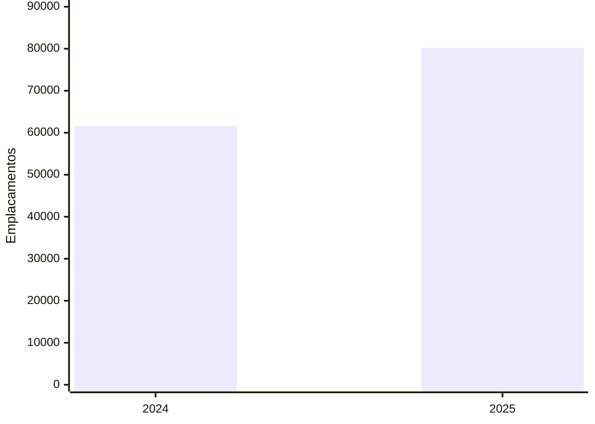
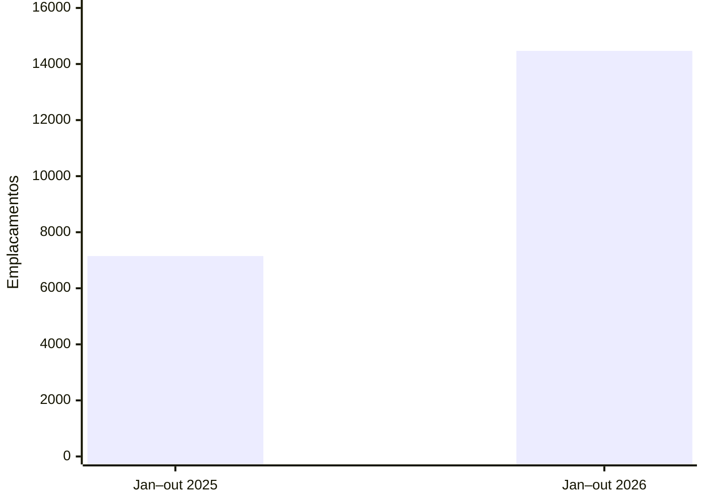
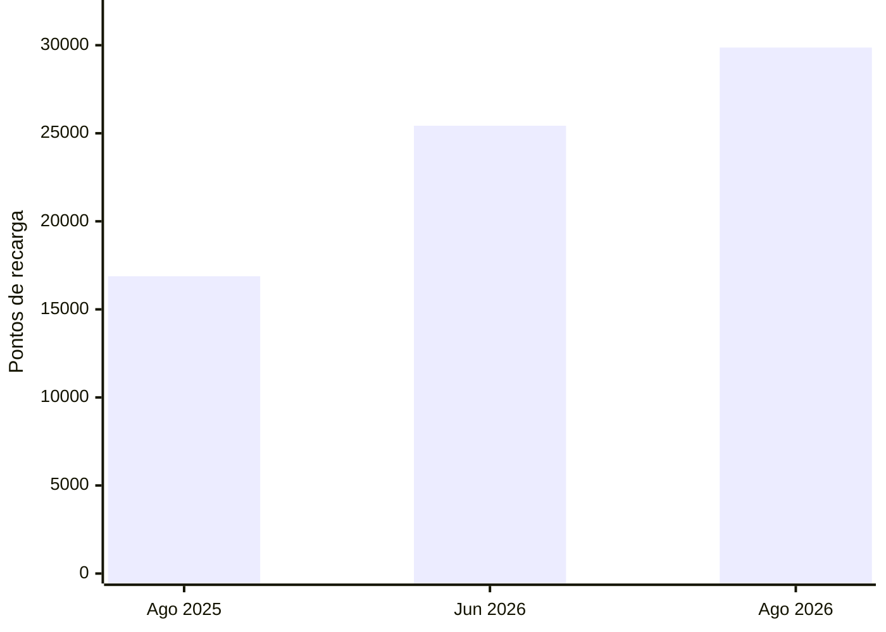
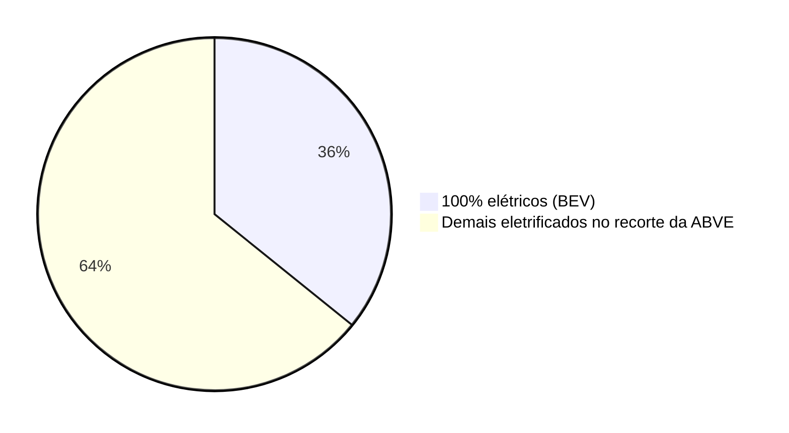

# Painel de mobilidade elétrica no Brasil

**Dados observados** · Brasil · Último período disponível por indicador · Consulta em 20/11/2026

| Veículos leves 100% elétricos | Motos elétricas | Pontos públicos e semipúblicos de recarga |
| :--- | :--- | :--- |
| **80.178** emplacamentos em 2025 | **14.469** emplacamentos de jan. a out. de 2026 | **29.866** pontos em ago. de 2026 |
| **↑ 30,13%** ante 2024 · +18.563 unidades | **↑ 102,39%** ante jan.–out. de 2025 · +7.320 unidades | **↑ 76,93%** ante ago. de 2025 · +12.986 pontos |

## Evolução dos indicadores

### Veículos leves 100% elétricos

### Motos elétricas

### Infraestrutura de recarga

As barras representam levantamentos em datas específicas. Os intervalos entre as datas são diferentes.

### Participação dos BEV entre os veículos leves eletrificados em 2025

Os BEV representaram **35,8%** dos **223.912** veículos leves eletrificados emplacados em 2025. O denominador corresponde ao recorte da ABVE e inclui híbridos.

## Como conferir os dados

| Indicador | Fonte e recorte |
| :--- | :--- |
| Emplacamentos de BEV leves e participação nos eletrificados | [ABVE, balanço de 2025](https://abve.org.br/eletrificados-crescem-dez-vezes-mais-do-que-conjunto-do-mercado-em-2025-com-224-mil-veiculos-vendidos/) |
| Emplacamentos de motos elétricas | [Fenabrave, informativo de outubro de 2026](https://www.fenabrave.org.br/portal/files/2026_10_02%202.pdf) · Use a linha **B) Elétricos**. O recorte pode incluir modelos além das scooters. |
| Pontos públicos e semipúblicos | [ABVE/Tupi, posição de agosto de 2026](https://abve.org.br/recarga-rapida-dc-quase-triplica-em-12-meses-e-ja-responde-por-38-da-rede-brasileira/) |

A variação percentual é calculada por `(atual ÷ base − 1) × 100`. Confira os [valores e resultados em CSV](kpis.csv), a [consulta SQL](kpis.sql) e as [notas de leitura](kpis.md).

Os indicadores acima medem emplacamentos e infraestrutura. Os valores de consumo em TWh e potência em GW ficam na [simulação de demanda](README.md), com hipóteses explícitas de frota e simultaneidade de recarga.
